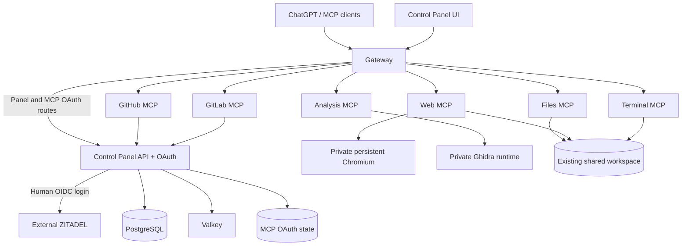

# Briareus V1 architecture

Briareus V1 develops the legacy platform in branch `v1`, beginning at commit
`7b1e8a98`. The larger Briareus architecture is retained in `v2`; it is not the
implementation baseline for this branch. The V1 foundation is tracked in #546.

## V1 authority and boundaries

The accepted V1 change is a small decomposition of the existing platform:
independent dependencies, Gateway, Control Panel API, Control Panel UI and MCP
providers, with ZITADEL for human identity. V2-specific Rauthy, Node/Cedar and
gRPC-only designs are not prerequisites for this V1 change. Clean Architecture
still applies inside each existing owner: domain invariants point inward,
application use cases depend on ports, and runtime/provider implementations stay
in infrastructure. This does not authorize a new identity signer, an authority
bypass, loss of data or a production cutover.

PostgreSQL, Valkey, persistent Chromium and the repository Ghidra MCP engine/bridge
share one dependencies deployment. All Briareus runtime services use one common
application network; production ZITADEL is external. A separate optional local
ZITADEL fixture supports tests without joining that network.

The diagram defines the V1 target, not evidence that a deployed environment has
already switched identity or storage. Source, parser, build, runtime and real
consumer acceptance are separate checkpoints.

## Source ownership

- `auth_service` owns the external MCP OAuth facade, registration, exact resource
  audiences, token state and private verification. ZITADEL replaces the upstream
  GitHub human login; GitHub MCP credentials remain provider-owned credentials.
- `bridge` owns public routing and protected-resource metadata. It adapts
  transport to existing API and MCP contracts rather than orchestrating business
  rules.
- `common` contains only actually reused typed settings, runtime and transport
  contracts. Each shared component lists its real deployment consumers.
- `control_panel_api` owns accounts, encrypted provider credentials, browser
  sessions, API/realtime use cases and telemetry coordination.
- `control-panel-ui` owns the panel frontend and hosted-login entrypoint. It
  collects no human password and stores no identity tokens.
- `modules.<provider>` owns that MCP provider's implementation and deployment.
  `modules.web` attaches to Chromium over private CDP; it does not own the browser
  process lifetime. `modules.analysis` remains the public facade for Ghidra.

## Authentication and state preservation

Panel sign-in uses the same-origin `/api/auth/login`, a backend-owned ZITADEL
OIDC callback and a server-owned session. Session lookup is authoritative;
browser-local flags cannot admit a user during an outage. Mutations require the
current session, the agreed same-origin check and `X-CSRF-Token`. Logout removes
local session authority even if an upstream provider operation fails.

Each public MCP endpoint remains a distinct exact resource audience. Gateway
publishes protected-resource metadata; the MCP OAuth facade owns registration,
PKCE, issuance, refresh rotation and replay protection. A direct ZITADEL DCR swap
does not prove this contract: its `resource` parameter is accepted but ignored.
The ZITADEL adapter must preserve these endpoint boundaries explicitly.

The source migration preserves existing account/workspace data and signing or
encryption material. A new local stand uses separate state and local credentials;
it must not mount saved V2/Rauthy data. No automatic live reset, secret rotation,
principal mapping or authentication fallback is part of this change.

The Control Panel database is PostgreSQL. SQLAlchemy defines application models;
Alembic owns the installed schema and its version history. The API upgrades the
schema before startup. Identity/session repositories use the same migrated
metadata and do not create tables. A clean installation starts from the initial
revision; existing unversioned PostgreSQL state is accepted only after matching
the complete baseline. SQLite transfer tools and runtime fallbacks are absent.
Preserve encryption and signing keys across schema and application upgrades.

Existing local-password panel sessions must sign in again through ZITADEL.
The old `management_admin` session entry is not converted to a verified ZITADEL
identity from its username. This authentication boundary preserves the account,
configuration and audit records and does not authorize a live cutover.
Existing MCP clients whose upstream identity was GitHub also reauthenticate:
their old claims are not relabelled as ZITADEL issuer/subject. Preserve the MCP
signing key and point `MCP_OAUTH_STATE_DIRECTORY` at the existing OAuth proxy root
when planning a real migration; upstream collection names, derivation/encryption
format and stored audit remain owned by the facade. A fresh local volume does
not prove compatibility or authorize deleting the previous OAuth state.

The remaining historical identifiers have explicit migration semantics:

| Identifier | V1 handling |
| --- | --- |
| Browser preferences `mcp-bridge:ui:v2` and `mcp-management:ui` | Copy valid preferences once into `bri:ui:v1`; preserve old values for rollback |
| Cached browser authentication hints | Never used as authority or converted into a ZITADEL session |
| Existing `management_config` SQL table | Preserve physical table/data until a separately reviewed schema migration |
| API settings field `management` and topic `management.events` | Preserve wire identifiers while all current consumers use the same contract |
| Existing Valkey namespace, encryption keys and workspace paths | Preserve configured state ownership; a new default is only for a new local stand |
| `legacy-mcp-bridge` branch and historical deployment documentation | Keep as source/rollback provenance, not the active product name |

## Deployment and update boundaries

Stable dependencies share a deployment unit when their lifecycle is coherent;
the Dependencies unit contains PostgreSQL, Valkey, Chromium and Ghidra. Production
ZITADEL remains external, with a separate opt-in local test fixture. Gateway,
Control Panel API, UI and each MCP implementation have independent build and
update boundaries. Chromium and Ghidra keep their persistent state and separate
lifecycles: a provider redeploy must not stop them.

Use a deliberate private network for the environment and service DNS. CDP,
databases and administrative listeners remain private. For Coolify, verify actual
network membership, parsed entrypoints and stored Watch Paths independently of
the Git definitions.

Each Watch Path covers the owner's source, Dockerfile, dependency inputs and
manifest, plus only its actual shared dependency closure. UI changes select UI;
one provider's changes select its own consumers. Dependency changes do not follow
every backend push. Preserve volume names, network aliases, external routes and
rollback before any existing deployment is split.

The public `/admin/` and `/api/*` paths remain compatibility contracts during
component renaming; MCP endpoints retain their existing independent paths.
See the system deployment documentation and the linked tasks in #546 for the
current source and acceptance state. Tests and fixtures begin only after all
source owners finish and the owner separately authorizes that phase.
