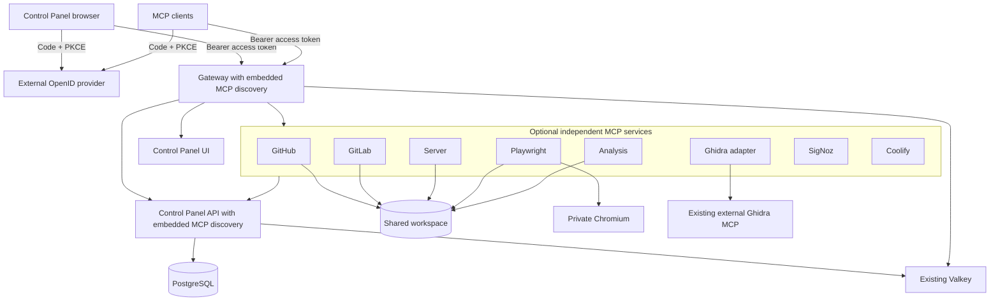

# Briareus V1 architecture

V1 is a clean installation alongside Legacy MCP Bridge, built from branch `v1`.
The separate `v2` branch remains available. Source changes do not constitute a
production cutover or authorize migration/deletion of Legacy data.

The external OIDC provider owns authentication, SSO cookies, users and OAuth token
lifecycle. The browser is a public Code + PKCE client using `oidc-client-ts`.
API/Gateway discover keys from the exact configured issuer and validate JWT access
tokens locally with a cached JWKS. Audience and application-role mapping are
explicit configuration. Role paths may address nested application roles or
organization-bound ZITADEL project grants. The required role is the configured
`BRIAREUS_NODE_ID`, with no global `access` fallback. API alone performs idempotent
node-role preparation through its provider administration adapter; the setup PAT
is never given to UI, Gateway or MCP hands.

MCP protected-resource metadata advertises the external issuer and configured
scopes. Each node accepts the shared API audience, not a distinct audience for each
MCP path. JWT access revocation takes effect at expiry; use short access-token
lifetimes. Metadata/JWKS expire after five minutes. See [OIDC](../oidc.md).

Browser HTTP uses Authorization Bearer; WebSockets offer `briareus.v1` and the
bearer token as subprotocols, negotiate only `briareus.v1`, and enforce exact
Origin. Expired connections close. Tokens are not passed in URLs. Pinia persistence
keeps provider-issued user and transaction records in localStorage. Valid tokens
are reused after reloads and across tabs; expired tokens are refreshed through the
provider, with cross-tab coordination. Failed renewal clears stored identity state.

`BRIAREUS_SERVICE_TOKEN` is one internal shared credential. Services reference
one environment Shared Variable and require a coordinated recreate after rotation.
Database/cache passwords, stored-credential encryption and upstream Chromium
control remain separate because they protect different non-OIDC facilities.
Provisioning PATs are used for ZITADEL setup, never for browser/MCP user access.

## Ownership and deployment

- `services/control-panel/ui` owns the frontend and standard OIDC client.
- `services/control-panel/api` owns application APIs, encrypted credentials,
  SQLAlchemy models and Alembic migrations, not user identity state.
- `services/gateway` owns HTTP/MCP routing and protected-resource discovery.
- `services/dependencies` owns PostgreSQL, Valkey and persistent Chromium.
- `services/hands/server` combines files and terminal in one workspace.
- `services/hands/svc/{github,gitlab}` owns the SVC providers.
- `services/hands/web/playwright` owns one Playwright MCP with internal/external modes.
- `services/hands/observability/signoz` and `services/hands/infrastructure/coolify`
  own separate telemetry and infrastructure MCPs.
- Analysis and the Ghidra adapter retain their independent source/build manifests.
- `deploy/templates/mcp-service.yaml` supplies shared internal MCP deployment defaults;
  generated Coolify files contain the resolved fields rather than nested inheritance.
- `shared/identity/token-verification` owns the narrow external JWT verification
  adapter. Shared capability leaves are consumed through explicit package imports.

There are four core resources and eight optional MCP hands. Dependencies contains
PostgreSQL, Valkey and Chromium as three containers. With all hands deployed this
is twelve resources and fourteen product containers on one environment network.
The existing Ghidra MCP engine and production OpenID provider are external. UI and
provider updates do not restart Dependencies. Each resource watches owner/consumed
shared directory globs ending in `/**`; MCP hands also watch the common deployment
template directory. Operator paths/handouts stay in ignored local state.

## Provider paths and availability

The independent endpoints are `/svc/github/mcp`, `/svc/gitlab/mcp`,
`/web/playwright/mcp`, `/server/mcp`, `/analysis/mcp`, `/analysis/ghidra/mcp`,
`/observability/signoz/mcp` and `/infrastructure/coolify/mcp`. There is no root
`/mcp` bridge, aggregate Web/Observability MCP or Google DevTools MCP service.
The public Ghidra adapter does not replace or redeploy the existing external engine.

`shared/services/catalog` defines provider identity/group/path contracts.
`shared/services/discovery` runs inside the existing API and Gateway. Runtime
registration uses short environment-scoped leases in the existing Valkey; private
network health responses must confirm provider identity and environment before a
service is connected. No Docker socket or additional discovery container is needed.
The panel displays connected providers and can show unavailable candidates. Missing
providers do not become required node dependencies; discovery never grants user access.

The new PostgreSQL baseline stores application data only. Repositories never
create tables; the API upgrades the Alembic schema before accepting requests.
No SQLite fallback or automatic Legacy import exists. Preserve Legacy encryption
keys, database backups and physical volumes until a separate migration plan.
The new authorization model requires new sign-in/connector authorization; old
Briareus/GitHub/Rauthy tokens are not converted into OIDC identities.
