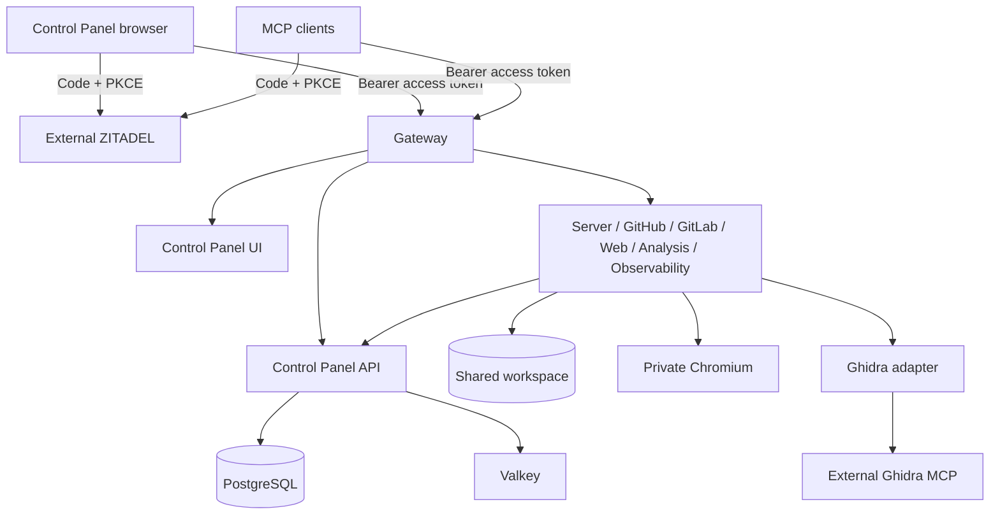

# Briareus V1 architecture

V1 is a clean installation alongside Legacy MCP Bridge, built from branch `v1`.
The separate `v2` branch remains available. Source changes do not constitute a
production cutover or authorize migration/deletion of Legacy data.

ZITADEL owns authentication, SSO cookies, users, project assignments and OAuth
token lifecycle. Briareus does not issue tokens, set login cookies, store user
sessions or refresh tokens, expose an OAuth facade or maintain a role matrix.
The browser uses `oidc-client-ts`, memory-only tokens and library-managed PKCE
transaction state. API/Gateway use PyJWT with cached JWKS; signatures, expiry,
issuer, project audience and the organization-bound project `access` assignment
are verified before requests. That single assignment grants full application
access. ZITADEL project administrator membership controls its console separately.

Protected-resource metadata points to ZITADEL. MCP clients are preregistered in
the Briareus project. Its shared project audience is not a per-MCP-URL audience;
ZITADEL currently ignores the `resource` authorization parameter. There is no
anonymous DCR setup or local proxy to disguise this limitation. Existing JWTs
remain valid until expiry after upstream access revocation; configure short
access-token lifetimes. Public JWKS sets expire after five minutes and refresh
on unknown key IDs. Tool calls do not require a ZITADEL request each time.

Browser HTTP uses Authorization Bearer; WebSockets offer `briareus.v1` and the
bearer token as subprotocols, negotiate only `briareus.v1`, and enforce exact
Origin. Expired connections close. Tokens are not passed in URLs. UI reloads
may redirect to the existing ZITADEL SSO session because tokens are memory-only.

`BRIAREUS_SERVICE_TOKEN` is one internal shared credential. Services reference
one environment Shared Variable and require a coordinated recreate after rotation.
Database/cache passwords, stored-credential encryption and upstream Chromium
control remain separate because they protect different non-OIDC facilities.
Provisioning PATs are used for ZITADEL setup, never for browser/MCP user access.

## Ownership and deployment

- `services/control-panel/ui` owns the frontend and standard OIDC client.
- `services/control-panel/api` owns application APIs, encrypted credentials,
  SQLAlchemy models and Alembic migrations, not user identity state.
- `services/gateway` owns HTTP/MCP routing and protected-resource discovery.
- `services/dependencies` owns PostgreSQL, Valkey and persistent Chromium.
- `services/hands/server` combines files and terminal in one workspace.
- Other `services/hands/<provider>` own their source/build/dependency manifests.
- `shared/identity/token-verification` owns the narrow external JWT verification
  adapter. Shared capability leaves are consumed through explicit package imports.

Eleven resources run thirteen product containers on one environment network.
Ghidra MCP and production ZITADEL are external. UI and provider updates do not
restart Dependencies. Each resource watches only owner/consumed shared directory
globs ending in `/**`. Operator paths/handouts stay in ignored local state.

The new PostgreSQL baseline stores application data only. Repositories never
create tables; the API upgrades the Alembic schema before accepting requests.
No SQLite fallback or automatic Legacy import exists. Preserve Legacy encryption
keys, database backups and physical volumes until a separate migration plan.
The new authorization model requires new sign-in/connector authorization; old
Briareus/GitHub/Rauthy tokens are not converted into ZITADEL identities.
