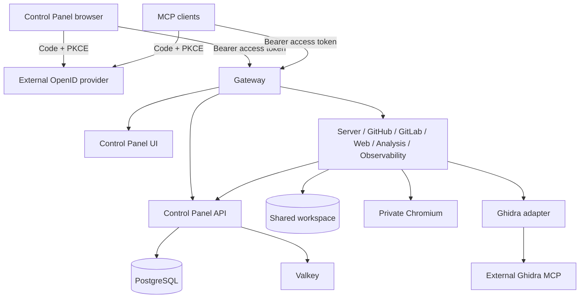

# Briareus V1 architecture

V1 is a clean installation alongside Legacy MCP Bridge, built from branch `v1`.
The separate `v2` branch remains available. Source changes do not constitute a
production cutover or authorize migration/deletion of Legacy data.

The external OIDC provider owns authentication, SSO cookies, users and OAuth token
lifecycle. The browser is a public Code + PKCE client using `oidc-client-ts`.
API/Gateway discover keys from the exact configured issuer and validate JWT access
tokens locally with a cached JWKS. Audience and application-role mapping are
explicit configuration. Role paths may address nested application roles or
organization-bound ZITADEL project grants. Provider administration remains outside
the runtime; only `scripts/bootstrap_zitadel.py` knows the ZITADEL management API.

MCP protected-resource metadata advertises the external issuer and configured
scopes. Each node accepts the shared API audience, not a distinct audience for each
MCP path. JWT access revocation takes effect at expiry; use short access-token
lifetimes. Metadata/JWKS expire after five minutes. See [OIDC](../oidc.md).

Browser HTTP uses Authorization Bearer; WebSockets offer `briareus.v1` and the
bearer token as subprotocols, negotiate only `briareus.v1`, and enforce exact
Origin. Expired connections close. Tokens are not passed in URLs. UI reloads
may redirect to the existing provider SSO session because tokens are memory-only.

`BRIAREUS_SERVICE_TOKEN` is one internal shared credential. Services reference
one environment Shared Variable and require a coordinated recreate after rotation.
Database/cache passwords, stored-credential encryption and upstream Chromium
control remain separate because they protect different non-OIDC facilities.
Provisioning PATs are used for ZITADEL setup, never for browser/MCP user access.

## Ownership and deployment

- `services/control-panel/ui` owns the frontend and standard OIDC client.
- `services/control-panel/api` owns application APIs, encrypted credentials,
  SQLAlchemy models and Alembic migrations, not user identity state.
- `services/gateway` owns HTTP/MCP routing and protected-resource discovery.
- `services/dependencies` owns PostgreSQL, Valkey and persistent Chromium.
- `services/hands/server` combines files and terminal in one workspace.
- Other `services/hands/<provider>` own their source/build/dependency manifests.
- `shared/identity/token-verification` owns the narrow external JWT verification
  adapter. Shared capability leaves are consumed through explicit package imports.

Eleven resources run thirteen product containers on one environment network.
Ghidra MCP and the production OpenID provider are external. UI and provider updates do not
restart Dependencies. Each resource watches only owner/consumed shared directory
globs ending in `/**`. Operator paths/handouts stay in ignored local state.

The new PostgreSQL baseline stores application data only. Repositories never
create tables; the API upgrades the Alembic schema before accepting requests.
No SQLite fallback or automatic Legacy import exists. Preserve Legacy encryption
keys, database backups and physical volumes until a separate migration plan.
The new authorization model requires new sign-in/connector authorization; old
Briareus/GitHub/Rauthy tokens are not converted into OIDC identities.
